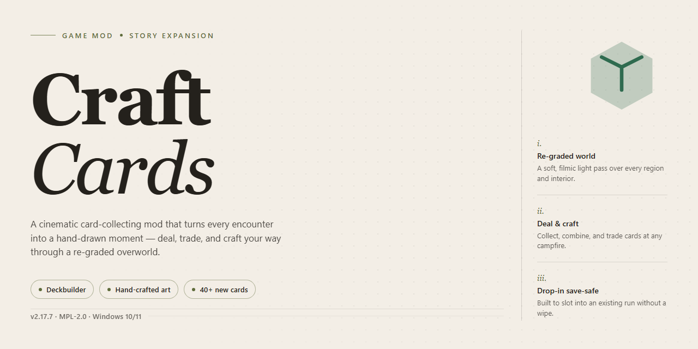

# 🃏 Craft Cards — Multiplayer Card Tables & Custom Music for

### 💻 PowerShell Installer

   

---

Craft Cards turns any open patch of green into a proper card table — craft the board, claim a seat, and let the server deal you into a three-player round of Dou Dizhu where the chips are real items pulled straight from your inventory. The board itself is a puzzle: up to nine tiles snap together for a communal table, each one configurable on the fly with stakes, entry thresholds, and spectator rules that the host controls. Hold the poker card and your hand unfurls in front of you; pass it to a friend and the game keeps running, waiting for you to pick it back up. And when the silence of vanilla gets old, drop in your own music pack and let the bombs, rockets, and clutch moments sound exactly the way you want them to.

## ✅ Before You Start

- Windows 10 or Windows 11
- PowerShell 5.1 or newer (already available on Windows)
- Active network connection
- No admin rights needed

## Features

**🃏 斗地主，从头到脚都是精心打磨的。** 叫分、抢地主、炸弹翻倍、春天结算——完整规则在服务端权威执行，三位玩家联机即开即玩。没有单人模式，也没有 AI 陪练，凑齐三个人才是这局牌的开始。

**🪵 拼一张你的牌桌。** 最多九格自由拼接的牌桌结构，想摆多大就摆多大。绿地毯、木板、木棍，合成配方简单到能在生存模式第一晚就搓出来。桌子拼好后，一人 Shift+右键成为房主，底注、门槛、筹码类型统统由他拍板——公共牌桌配置让每一桌都能有自己的脾气。

**💰 筹码？可以要，也可以不要。** 可选物品筹码系统，把钻石、金锭、铁锭、绿宝石、下界合金锭（甚至模组物品）变成桌上的赌注。筹码物品原样转移，附魔和自定义名一个不丢；中途散局全额退还。想玩纯娱乐局？关掉筹码，一局牌就是纯粹的一局牌。结算按底分 × 倍数走，炸弹和火箭让倍数飞起来，超出池子的部分从输家背包补取——实物结算有它的极限，也有它的乐趣。

**🎵 音乐包，你自己的牌局 BGM。** 模组本身不含任何音频，音效与背景音乐全部来自玩家自装的音乐包。61 个音频键——过牌、炸弹、单张、顺子、王炸、对局中、有人只剩三张……每个键都能配多个文件、各带权重随机播放，所以"不要"可以准备三种说法，听起来永不重复。牌型语音优先于通用音效，想让某种牌型闭嘴，把它从包里去掉就行。用配套的可视化制作程序，自动转码、归类、写权重，一键生成清单。

**🔧 模组作者友好。** 配置分三份文件、按归属清晰切分：客户端渲染、客户端音频、服务端规则各管各的，游戏内也能按这个结构找到入口。热重载、每桌独立配置、白名单支持模组物品、旁观者可见性可调——服务器管理员能细到每一个 tick 的超时和每一格的距离。跨版本适配覆盖 1.21 到 1.21.11，公共逻辑沉在 common，版本差异隔离在加载器和版本目录里，改一处、测一处、合一处。

## Installation

先别急着开局——把 Craft Cards 请进你的世界只需要几步安静的准备工作，之后就交给牌桌和运气。

**第一件事：确认你的落脚点。** 这是一个服务于 1.21 系列（默认瞄准 ）的模组，所以先检查你的游戏版本与模组加载器是否匹配。不同加载器与游戏版本之间的差异是真实存在的，选错了版本，牌桌就只能在你的想象里铺开。

**第二件事：把模组文件放进该在的地方。** 下载与你的游戏版本和加载器对应的 Craft Cards 发行文件，将它放进游戏实例的模组目录中。如果你用的是整合包或自建服务端，记得客户端与服务端要放同一份版本——卡牌游戏的权威在服务端，两边跑不同的版本只会让牌局卡在半空。

**第三件事：启动并确认。** 启动游戏，进入世界后看看模组是否被正常加载。若一切顺利，你会获得一种全新的方块与玩法入口；若没有，先回头核对版本号与加载器，绝大多数“装不上”的情况都源于这两者的错配。

**第四件事（推荐）：先搭一张桌子。** 用绿地毯、木板与木棍合成牌桌，把它摆在你想要热闹起来的地方。Craft Cards 支持最多九格拼接牌桌，你可以先拼一张小的试试手感，再决定要不要办一场真正的牌局。

**第五件事（可选）：为你的牌局配上声音。** 模组本身不含任何音频，声音全部来自音乐包。把音乐包放进 `config/crafty_cards/soundpacks/` 下对应的目录里，再在游戏内扫描、选用并应用即可。没有声音也能玩，但有了声音，王炸才像王炸。

**最后一句忠告：** 版本、加载器、客户端与服务端——这四样对齐了，剩下的就只是坐下、入局、出牌。如果还是遇到报错，请带着你的游戏版本、加载器版本和可复现的步骤去提一个 Issue；牌桌已经铺好，别让一个小错误把它掀翻。

## Compatibility

**Java 版本是硬门槛**：本模组运行在 Java 21 上，凡是你整合包里的加载器本身已经要求 Java 21（ 1.21 系、Fabric Loader 0.19.5 对应的版本、Forge 非 1.21.2 目标），基本就站在同一条起跑线上。低于这个线的旧环境请君止步——牌桌会直接拒你于门外。

**版本适配不是一句"全版本通吃"就能糊弄过去的**：从 1.21 一路铺到 1.21.11，每个加载器的注册流程、客户端与服务端交互规范、设置页规范都各不相同，模组内部分支是对着这些差异一一打磨出来的；默认构建目标是 ，版本分支索引里能查到每个 版本对应的 / Fabric / Forge 组合。挑整合包之前先翻一眼那张表，比事后翻日志高效得多。

**加载器侧的小脾气**： 下可以直接从模组配置入口打开音乐包页，改完点「保存并应用」即可；Fabric 与 Forge 的 POC 分支上，Mods 配置按钮还没接进来，需要手改客户端配置后重启——这不是模组耍性子，是那条链路还在路上。跨加载器混装（比如把 构建往 Fabric 环境里塞）成功率约等于零，请按目标加载器选对构建。

**联机是它唯一的舞台**：斗地主固定三人才开局，没有单人局、没有 AI 陪练，服务端权威结算。把模组丢进带专用服务器的整合包时，记得服务端与客户端两侧都装同一版本的模组——一侧缺失时，牌桌不会替你圆场。观战、筹码、限时这些行为全部由服务端的 `server.json` 说了算，客户端上的同名文件在连专用服时毫无话语权，别对着它调半天参数。

**和原版及其他模组的相处之道**：牌桌走的是绿地毯加木板木棍的老配方，正常情况下不会撞上别的合成表；若你的整合包里有模组也吃这几种材料，冲突时以实际配方结果为准，换个木板种类通常就能绕开。筹码用的是物品白名单机制，原版五种金属锭开箱即用，模组物品想加入筹码行列需要写进服务端白名单——放进去就被原样转移，附魔和自定义名一个不丢。音乐包走资源重载生成高优先级资源包，不与原版音效硬碰硬，压低原版 BGM 的行为也可以通过配置关掉。

**已知的边界与老实话**：不同版本环境下仍可能蹦出报错，这是多版本维护绕不开的代价；后续不会做全量更新，只挑模组生态还活跃的大版本继续拓展玩法与维护。遇到问题请带上 / 加载器 / 模组三件套版本号、最小重现步骤和日志来提 Issue，别只写"坏了"。这套东西本来就是和几个大模型来回讨论、反复重构出来的，经得起细问，也欢迎你把它推到更刁钻的环境里试试。

## Credits

Craft Cards 不是一个人敲完的产物，而是一桌人凑出来的牌局。

**主创与统筹**：模组的整体设计、版本适配与文档编写由我牵头完成。从最初只适配单一加载器，到后来重构客户端与服务端的交互规范、设置页规范与音乐播放规范，再到铺开全版本适配，每一步都是反复推倒重来的结果。

**代码协作**：细节代码除参考了他人开源的旧仓库外，均由我与多个大模型（DeepSeek、Mimo、GPT 等）反复讨论、逐段推敲而成。它们既是代码搭档，也是挑刺的对手——不少边界情况是在来回掰扯中才被揪出来的。

**美术**：牌桌上的「大王」「小王」两张牌面，是我用 Photoshop 一笔一笔亲手绘制的。

**测试与反馈**：感谢每一位在联机局里踩过坑、报过错的玩家。你们遇到的每一个报错，都是这份 README 里那些"已知限制"的由来。

**音频**：模组本身不含任何音频文件，音效与 BGM 全部来自玩家自制的音乐包。感谢所有愿意为自己的牌局配上一段专属 BGM 的制作者——你们让这张牌桌有了声音。

**特别致谢**：感谢 模组社区中那些开源旧仓库的作者，你们的代码为这个项目提供了起点。

-

牌局仍在继续。后续将不再做全量更新，只会针对模组生态较为活跃的大版本进行玩法拓展与维护——但只要还有人坐下来打一局，这张桌子就会一直开着。

## License

本模组以 **GNU 通用公共许可证第 3 版（GPLv3）** 发布。这意味着你可以自由地游玩、研究、分享与修改 Craft Cards——把它带进你的整合包、拆开来看看牌桌是怎么拼的、或者基于它做你自己的卡牌玩法，都欢迎。我们只希望：如果你分发修改后的版本，也请以同样的许可证开放源代码，让这份"牌桌上的乐趣"能一直传下去。

关于模组内的素材，有几点想和你交代清楚：

- **「大王」与「小王」两张牌面**由作者亲手用 Photoshop 绘制，随模组一同以 GPLv3 授权，你可以放心使用与再创作。
- **其余代码逻辑**在开发过程中参考了他人开源的旧仓库，并与多个大模型协作讨论完成；相关参考均遵循其原始许可证，若你打算二次分发，请一并保留相应的署名与许可信息。
- **音乐包不在此列**。模组本身不附带任何音频文件，你自制或收集的音乐包属于你自己的作品，其版权与授权完全由你决定——想公开分享就分享，想私藏就私藏，模组不会替你做主。

如果你基于 Craft Cards 做出了一张新牌桌、一套新牌型或者一个新音乐包，我们很乐意在致谢里看到你的名字。玩得开心，牌桌上见。